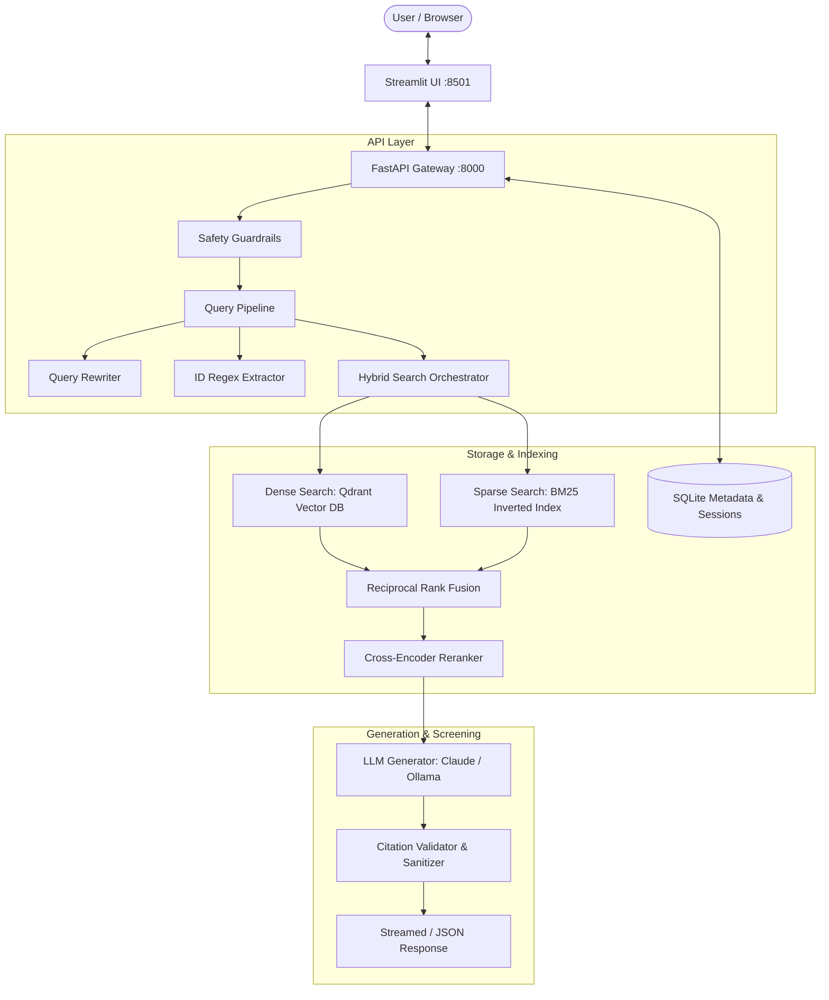

# CyberSense Architecture Documentation

## 1. Executive Overview

CyberSense is an enterprise-grade Retrieval-Augmented Generation (RAG) system engineered specifically for cybersecurity knowledge synthesis. It indexes authoritative threat frameworks (MITRE ATT&CK, CWE, CAPEC), vulnerability databases (CISA KEV, NVD), security standards (NIST SP 800-53, SP 800-63B), OWASP defense guides, and internal organizational runbooks.

Every response produced by CyberSense contains exact, verified inline citations (`[1]`, `[2]`), and the system strictly abstains ("I couldn't find...") when facts are not supported by the retrieved knowledge base.

---

## 2. Component Breakdown

### 2.1 Ingestion Engine (`cybersense.ingestion`)
- **`BaseLoader`**: Common abstract interface for all source connectors (`kev`, `attack`, `cwe`, `capec`, `nvd`, `pdf`, `markdown`, `html`).
- **Heading-Aware Prose Chunking**: Splits markdown and documents along logical headers, maintaining hierarchical breadcrumbs (`section_path`) and token overlaps.
- **Structured Record Chunking**: For records like ATT&CK techniques, CWE entries, and CVEs, repeats primary identifiers and titles at the top of every chunk so they remain searchable even across deep splits.
- **Entity Extraction**: Normalizes and indexes security identifiers (CVEs, CWEs, CAPECs, ATT&CK techniques, NIST controls) into the chunk metadata payload.
- **Idempotent SQLite Registry**: Tracks document content hashes (`content_hash = SHA256(text)`). Ingestion pipelines detect un-modified files and skip redundant re-embedding.

### 2.2 Dual Retrieval & Fusion (`cybersense.retrieval`)
- **Query Rewriting**: Contextualizes multi-turn conversations into standalone search queries before submission.
- **ID Short-Circuiting**: Direct exact-match filters in Qdrant for queries mentioning specific IDs (e.g. `CVE-2021-44228`).
- **Dense Vector Search**: `sentence-transformers/all-MiniLM-L6-v2` (384-dimensional dense vectors) stored in Qdrant with Cosine distance.
- **Sparse BM25 Search**: Inverted index implemented with token-level frequency matching over all chunks in the knowledge base.
- **Reciprocal Rank Fusion (RRF)**: Merges dense and sparse ranked lists using standard $RRF(d) = \sum \frac{1}{k + r_i(d)}$ with $k=60$.
- **Cross-Encoder Reranker**: `cross-encoder/ms-marco-MiniLM-L-6-v2` scores the fused candidate pool to ensure high semantic precision.

### 2.3 Generation & Guardrails (`cybersense.generation`)
- **Defensive Guardrails**: Regex matching blocks prompts demanding functional exploit code, malware compilation, or unauthorized network penetration.
- **Context Injection Sanitizer**: Redacts adversarial override patterns (`ignore previous instructions`, etc.) embedded inside retrieved chunks.
- **Citation Validator**: Scans LLM responses for `[n]` bracket notations, strips any numbers that do not map to retrieved chunks, and constructs structured `Citation` objects containing URLs, document titles, and source snippets.

### 2.4 API & UI Interfaces
- **FastAPI Backend**:
  - `POST /api/v1/chat`: Async chat endpoint supporting both standard JSON and Server-Sent Events (SSE) streaming.
  - `POST /api/v1/documents`: Document upload endpoint validating file formats and maximum upload size limits.
  - `GET /api/v1/admin/stats`: Document and chunk statistics grouped by knowledge source.
  - `slowapi` rate limiting on chat endpoints to prevent abuse.
- **Streamlit Frontend**:
  - Interactive multi-turn chat interface.
  - Expandable citation cards with source tags, URLs, and snippet previews.
  - Sidebar filters for source selection (ATT&CK, CVE, CWE, NIST, OWASP, Uploads) and top-k tuning.
